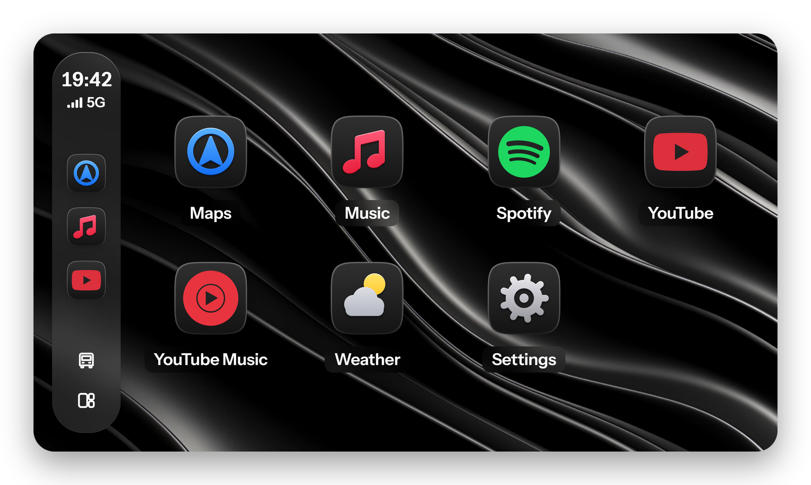
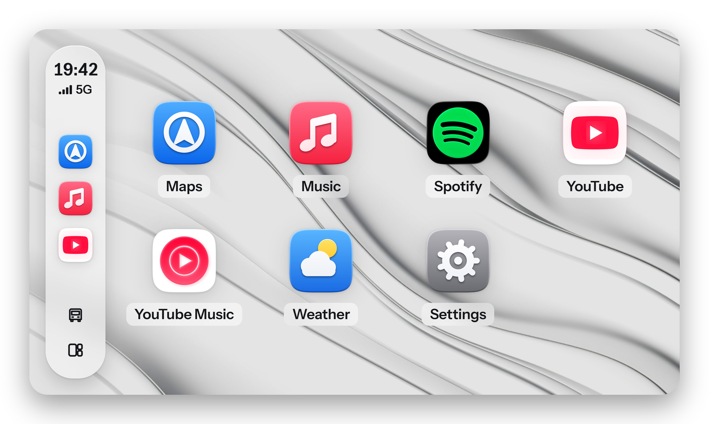
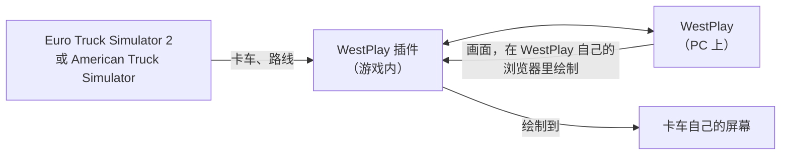

# WestPlay 改进版

> **本仓库是 jntm-5686 在原版 WestPlay 基础上修改的版本，不是原版。**
> 原版由 enes-less 开发维护，[原版页面在这里](https://github.com/enes-less/WestPlay)。
> 本版的全部改动由 jntm-5686 一人完成，遵循 GPL-3.0-or-later。

本版相对原版的主要改动：

- 车机屏 / 平板改为运行时开关，不再自动接管
- 内置 YTHQ 平板与福特中控屏补丁，无需另装 .scs
- 中文拼音输入法、性能模式与帧率限制、图标主题
- 品牌开机动画、沃尔沃 VNL 2025 空间音效（美卡）

<p align="center">
  <a href="https://github.com/jntm-5686/Westplay-improved-version/releases/latest"></a>
  
  
  <a href="LICENSE"></a>
</p>

<p align="center">
  <a href="#功能">功能</a> ·
  <a href="#支持的车辆">支持的车辆</a> ·
  <a href="#声音">声音</a> ·
  <a href="#安装">安装</a> ·
  <a href="#隐私">隐私</a>
</p>

<br>



WestPlay 把一块车机风格的屏幕放进卡车自己的仪表台，在游戏里显示——欧卡 2 与美卡共用同一个 WestPlay。用你自己的游戏生成的地图画路线，加上音乐、YouTube、沿途天气：就在真车中控屏的位置上，用鼠标操作，按住一个键就能接管。

## 功能

<table>
  <tr>
    <td width="50%" valign="top">
      
      <h3>来自你自己游戏的地图</h3>
      由游戏地图生成，含 ProMods 等地图 mod，显示你的路线与逐向引导；搜索目的地会把停靠点加进游戏自带的 GPS。
    </td>
    <td width="50%" valign="top">
      
      <h3>驾驶仪表盘</h3>
      地图旁边是正在播放的音乐和你要去的地方，沿途天气也在，一屏就能看完。
    </td>
  </tr>
  <tr>
    <td width="50%" valign="top">
      
      <h3>你的音乐</h3>
      Apple Music、Spotify 与 YouTube Music，带正在播放和歌词；歌曲的 MV 可以直接在正在播放里播；YouTube 有频道、播放列表、字幕与清晰度。Player 播放你放进游戏音乐文件夹里的歌。
    </td>
    <td width="50%" valign="top">
      
      <h3>深浅色与自定义</h3>
      夜里或开灯时自动转深色，像车上的光线传感器；可以换自己的壁纸与应用图标。
    </td>
  </tr>
</table>

PC 上的**伴生程序**负责全部安装：找到你的游戏（欧卡、美卡或两者），把 WestPlay 装进每个游戏、生成地图，并保持更新。

## 工作原理



WestPlay 在 PC 上用自己的浏览器画界面，插件把每一帧画到游戏里的卡车屏幕上。卡车自己的屏幕和它的信息栏仍然归游戏所有：WestPlay 取代 GPS 的位置，车辆信息栏是否保留由 Vehicle Bar 设置决定。

## 支持的车辆

WestPlay 有两种显示位置：卡车自带的屏幕，或者 WestPlay 平板。

**卡车自带屏幕**（现实里有 CarPlay 的车），欧卡 2：

- **DAF** XF 与 XG/XG+ 2021、XF Electric、XD（以及 Jasper 的 DAF 2021）
- **Scania** S 与 R（7 寸屏或 Smart Dash），以及 S BEV
- **Iveco** S-Way
- **Renault** T（2024）
- **Volvo** FH（2021 与 2024）
- **Coaches DLC**：Scania Touring、MAN Lion's Coach（2024）
- **Oyuncuyusbis 客车**：Mercedes-Benz Travego 16 SHD、MAN Lion's Coach、Setra S 531 DT
- **Setra S 516 HD/2**（Oyuncuyusbis）：装在客车自带 GPS 屏上，需在改装店加装

**WestPlay 平板**：其余所有车（含 mod 卡车），在改装店装一块平板即可（配件 › 挂饰，或仪表台套装）。

**美卡**：所有车都支持平板；福特 F-150（2023）与 Bronco（2024）的中控屏可直接使用（补丁已内置）。

本版取消了原版「平板进入视野即自动接管」的行为，显示位置完全由设置里的「卡车屏幕 / WestPlay 平板」开关决定，切换立即生效。

## 声音

音乐从车内实际喇叭的位置发出，按喇叭位置分频播放。欧卡 2 支持：

- Scania S、R（2016）、S BEV——门板低音、A 柱高音、车顶低音
- Scania R（2009）、Streamline——门板低音、A 柱高音
- DAF XF（105）——A 柱高音；Super Space Cab 车顶两组，其余车型一组
- DAF XF Euro 6——门板低音、A 柱高音；Super Space Cab 车顶两组，其余一组
- DAF XF、XG、XG+（2021）、XF Electric、XD——门板低音、A 柱高音、车顶一组、中置
- MAN TGX——门板低音；XXL 车型两侧墙体高处各一只
- MAN TGX Euro 6——门板低音；XL 车型每个车顶角各一只
- MAN TGX（2020）——每扇门一个低音加一个中音，A 柱高音
- Mercedes-Benz Actros（2014）——门板低音、车顶一组、A 柱高音
- Mercedes-Benz Actros（2009）——门板低音、车顶前角两只
- Volvo FH（2021、2024）、FH16（2012）——门板低音、后墙低音
- Volvo FH16（2009）——每扇门一只
- Iveco Stralis——车顶控制台两端各一只，高顶车型乘客侧多一只
- Iveco Hi-Way——车顶控制台两端各一只，两侧高处各一只
- Iveco S-Way——每扇门一个低音加一个高音
- Renault Magnum——每个车顶角一只，车顶控制台高音
- Renault Premium——车顶两侧各一只，低顶车型位置更靠下
- Renault T——A 柱高音、后墙一对；2024 内饰另有门板低音
- Renault E-Tech T——门板低音、A 柱高音、后墙一对
- JuseeTV 的 Scania PGR——按装的配件决定：门、A 柱、顶部控制台、后墙

美卡目前支持 **Volvo VNL 2025**（四只喇叭：仪表台两侧前角高音 + 两扇门板前下方低音）。其余车辆按普通立体声播放。

## 安装

1. 下载[最新版本](https://github.com/jntm-5686/Westplay-improved-version/releases/latest)的安装包并运行。
2. 伴生程序会自动打开，带你完成剩下的步骤：找到游戏、安装插件与屏 mod、生成地图。
3. 启动游戏，坐进卡车。

**系统要求**：Windows 10 或 11（64 位）；欧卡 2 与美卡 1.62（其它版本可能也可用，未测试时伴生程序会提示）；Microsoft Edge WebView2（Windows 11 自带，缺失时安装程序会补上）。

## 隐私

WestPlay 没有自己的服务器、账号和统计，不收集也不发送任何关于你的信息。

- Apple Music、Spotify、YouTube 都在它们自己的页面登录，用的是 PC 上 WestPlay 自己的浏览器配置，和普通浏览器一样。WestPlay 不保存任何账号数据。
- 地图在你本机由游戏生成，只留在本机。
- WestPlay 只与你使用的服务、GitHub（检查更新）通信。

## 从源码构建

需要 Windows、[Rust](https://rustup.rs)（stable）与 [Node.js](https://nodejs.org) 24。

```sh
npm install      # 伴生程序与界面的依赖
npm run dev      # 启动 WestPlay，界面实时热更新
```

测试：`cargo test --workspace` 与 `npm test --prefix ui`；游戏插件用 `cargo build --release -p westplay-plugin` 构建。

## 支持

WestPlay 是免费的。本版不设赞助入口，也没有赞助者或致谢对象；问题、建议和 bug 直接开 [Issue](https://github.com/jntm-5686/Westplay-improved-version/issues)。

## 许可

WestPlay 是自由软件：你可以遵循 GNU 通用公共许可证（GPL）第 3 版或（由你选择）任何更新版本重新发布和修改它。详见 [LICENSE](LICENSE)。

本版随附的第三方库保留各自许可证：见 [THIRD_PARTY_LICENSES.md](THIRD_PARTY_LICENSES.md)，以及 [THIRD_PARTY_NOTICES.md](THIRD_PARTY_NOTICES.md)。

WestPlay 是独立项目，与 Apple、SCS Software、Spotify、Google 及各卡车厂商无关，也未获其认可。CarPlay、Apple Music、Spotify、YouTube、YouTube Music 以及各厂商名称与标识均为各自所有者的商标，仅用于说明 WestPlay 所支持的对象。
