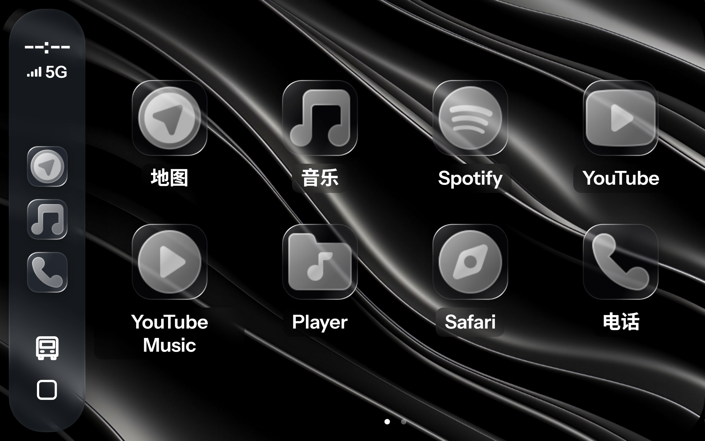
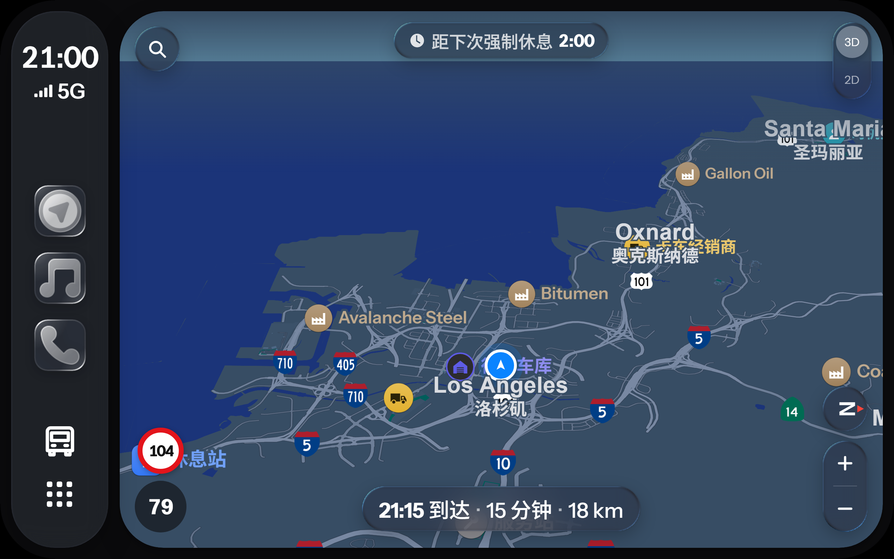
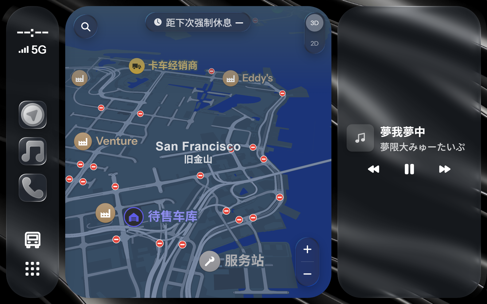
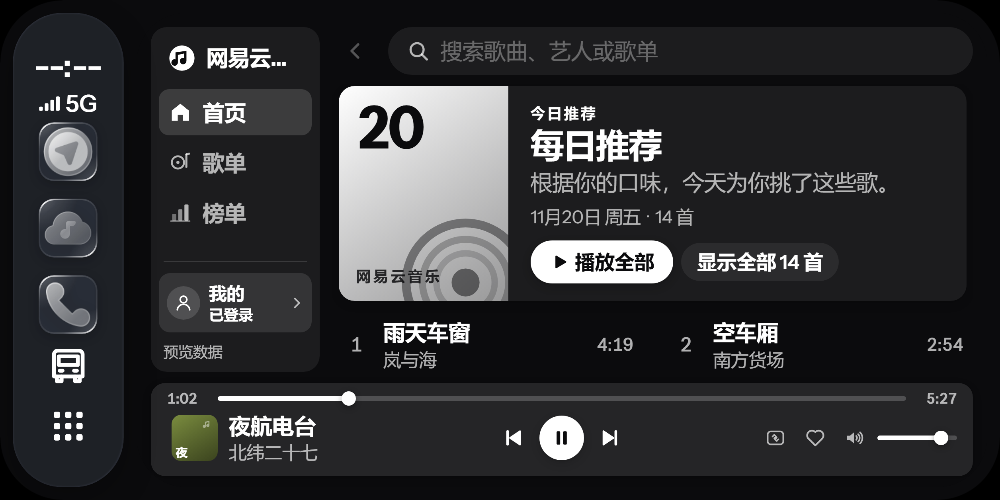
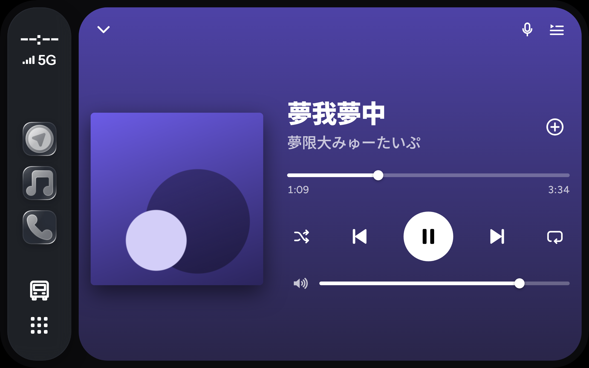
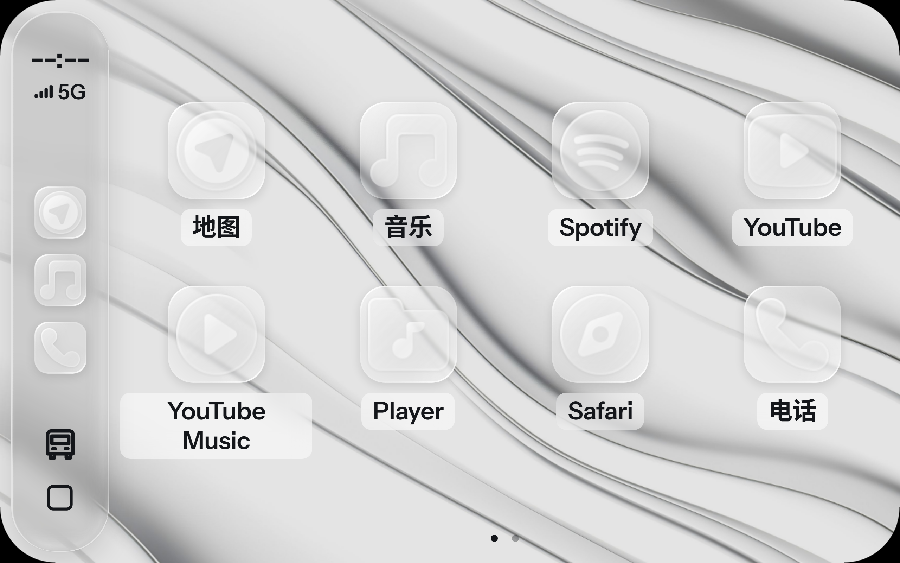
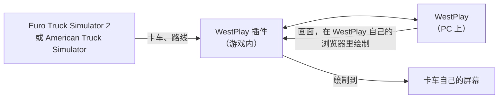

# WestPlay 改进版

> **本仓库是 jntm-5686 在原版 [WestPlay](https://github.com/enes-less/WestPlay) 基础上修改的版本，不是原版。**
> 原版由 enes-less 开发维护，遵循 GPL-3.0-or-later；本版的全部改动由 jntm-5686（estella）一人完成。
> English description: [see below](#english).

<p align="center">
  <a href="https://github.com/jntm-5686/Westplay-improved-version/releases/latest"></a>
  
  
  <a href="LICENSE"></a>
</p>

<p align="center">
  <a href="#与原版的区别">与原版的区别</a> ·
  <a href="#ythq-平板">YTHQ 平板</a> ·
  <a href="#功能">功能</a> ·
  <a href="#支持的车辆">支持的车辆</a> ·
  <a href="#安装">安装</a> ·
  <a href="#支持">支持</a>
</p>

<br>



WestPlay 把一块车机风格的屏幕放进卡车自己的仪表台，在游戏里显示——欧卡 2 与美卡共用同一个 WestPlay。用你自己的游戏生成的地图画路线，加上音乐、YouTube、沿途天气：就在真车中控屏的位置上，用鼠标操作，按住一个键就能接管。

## 与原版的区别

本版不是简单汉化，而是在原版基础上做了下面这些改动：

**屏幕与补丁**

1. **车机屏 / 平板改为运行时开关**——原版会在平板进入视野时自动接管，本版取消自动切换，完全由设置里的「卡车屏幕 / WestPlay 平板」决定，切换立即生效。
2. **内置车机适配补丁**：YTHQ 平板（欧卡、美卡）、福特 F-150 2023 / Bronco 2024 中控屏、福特 Mustang '67 / Victoria '06 的平板 UV 修正——都不需要另外安装 `.scs`。
3. **YTHQ 平板彻底分流**（欧卡 2 与美卡都支持，35 个车系、248 个配件定义，含 3 台客车）：装了 YTHQ 时，「车辆屏幕」显示 YTHQ 原界面、「WestPlay 平板」显示 WestPlay 平板页；卸掉 YTHQ 后原厂屏显示该车的布局，平板使用独立贴图，不再拉伸。
4. **福特中控屏**：关闭 WestPlay 时显示原车 SYNC 4 界面，倒车影像提到画面之上。

**界面与操作**

5. **中文拼音输入法**：离线词库（4.9 万条），键盘上方出候选卡片，支持整词和首字母。
6. **性能模式与帧率限制**：关闭玻璃模糊、动画和地图 3D 建筑；帧率可锁 30。
7. **图标主题**：原版图标 / 液态玻璃图标（13 个应用全覆盖）。
8. **品牌开机动画**：DAF、Volvo、Scania、MAN、Renault、Iveco、Kenworth、Peterbilt、Mack、Freightliner、International、Ford、Western Star、Setra 等 15 个品牌；无品牌标识的车型不显示文字。

**地图与声音**

9. **地图休息药丸**：轮播「距离下次强制休息还有多久」和「距离最近的休息站」；地图右上角有 2D / 3D 开关。
10. **空间音效**：美卡已实测沃尔沃 VNL 2025、福莱纳 Cascadia 2024、福特 Bronco 2024、福特 F-150 2023 的喇叭定位（详见下方「声音」）；车外改为完全静音（播放不中断）；Esc 菜单打开时音乐暂停，关闭后继续。
11. **默认搜索引擎改为 Bing**（可在车机设置里改回）。

**其它**

12. **赞助页 / 社交栏改为爱发电**，见下。
13. **自动更新指向本仓库**，不再从原版仓库拉更新（避免改进版被原版覆盖）。

**应用**

14. **新增网易云音乐车机版 V1.3**（原版没有）：车机里独立 App，仿桌面版现代界面、大字号精简布局；登录在伴生程序的「账号」页扫码完成；**接入了车内空间音效**（按卡车喇叭位置分频定位 + 头部追踪，车外与 Esc 菜单自动静音）；首页每日推荐、榜单、按账号同步的我的歌单/最近播放、在线搜索（歌曲/艺人/歌单）、红心同步；**滚动歌词**（未展开三行、可展开全屏跟唱、点句跳转、纯音乐标记、中文界面显示翻译）；**艺人页**（热门 50 首 / 全部歌曲分页 / 专辑分页 / 资料统计）；**播放模式**（列表循环 / 随机 / 单曲循环）；按所在列表顺序切歌；沉浸式正在播放（iOS 式展开与收起动画）；长列表分页浏览、回到原滚动位置；界面风格可选「跟随体系 / 网易云红」，浅色深色自动跟随。

## YTHQ 平板

> 本版的「YTHQ 平板分流」需要先安装 YTHQ Tablet 模组；只认创意工坊位置，把 `.scs` 拷到 `Documents\...\mod` 不生效。
> 两个游戏各用自己的创意工坊条目（欧卡 `3595920707`、美卡 `3598886740`），同时安装也能各自识别。

| 游戏 | 模组 | 链接 |
|---|---|---|
| 欧卡 2 | YTHQ Tablet | https://steamcommunity.com/sharedfiles/filedetails/?id=3595920707 |
| 美卡 | YTHQ Tablet | https://steamcommunity.com/sharedfiles/filedetails/?id=3598886740 |
| 美卡（福特车型） | YTHQ GPS For Ford | https://steamcommunity.com/sharedfiles/filedetails/?id=3838495473 |

## 功能

<table>
  <tr>
    <td width="50%" valign="top">
      
      <h3>来自你自己游戏的地图</h3>
      由游戏地图生成，含 ProMods 等地图 mod，显示你的路线与逐向引导；搜索目的地会把停靠点加进游戏自带的 GPS。
    </td>
    <td width="50%" valign="top">
      
      <h3>驾驶仪表盘</h3>
      地图旁边是正在播放的音乐和你要去的地方，沿途天气也在，一屏就能看完。
    </td>
  </tr>
  <tr>
    <td colspan="2" valign="top">
      
      <h3>网易云音乐车机版 V1.3（本版新增）</h3>
      车机里独立的网易云：每日推荐、榜单、我的歌单与最近播放、在线搜索，红心与账号同步；滚动歌词跟着声音走，可展开全屏跟唱；播放模式（列表循环 / 随机 / 单曲循环）与按列表顺序切歌；声音接进车内空间音效。
    </td>
  </tr>
  <tr>
    <td width="50%" valign="top">
      
      <h3>你的音乐</h3>
      Apple Music、Spotify 与 YouTube Music，带正在播放和歌词；歌曲的 MV 可以直接在正在播放里播；YouTube 有频道、播放列表、字幕与清晰度。Player 播放你放进游戏音乐文件夹里的歌。
    </td>
    <td width="50%" valign="top">
      
      <h3>深浅色与自定义</h3>
      夜里或开灯时自动转深色，像车上的光线传感器；可以换自己的壁纸与应用图标。
    </td>
  </tr>
</table>

PC 上的**伴生程序**负责全部安装：找到你的游戏（欧卡、美卡或两者），把 WestPlay 装进每个游戏、生成地图，并保持更新。

## 工作原理



WestPlay 在 PC 上用自己的浏览器画界面，插件把每一帧画到游戏里的卡车屏幕上。卡车自己的屏幕和它的信息栏仍然归游戏所有：WestPlay 取代 GPS 的位置，车辆信息栏是否保留由 Vehicle Bar 设置决定。

## 支持的车辆

WestPlay 有两种显示位置：卡车自带的屏幕，或者 WestPlay 平板。

**卡车自带屏幕**（现实里有 CarPlay 的车），欧卡 2：

- **DAF** XF 与 XG/XG+ 2021、XF Electric、XD（以及 Jasper 的 DAF 2021）
- **Scania** S 与 R（7 寸屏或 Smart Dash），以及 S BEV
- **Iveco** S-Way
- **Renault** T（2024）
- **Volvo** FH（2021 与 2024）
- **Coaches DLC**：Scania Touring、MAN Lion's Coach（2024）
- **Oyuncuyusbis 客车**：Mercedes-Benz Travego 16 SHD、MAN Lion's Coach、Setra S 531 DT
- **Setra S 516 HD/2**（Oyuncuyusbis）：装在客车自带 GPS 屏上，需在改装店加装

**WestPlay 平板**：其余所有车（含 mod 卡车），在改装店装一块平板即可（配件 › 挂饰，或仪表台套装）。

**美卡**：所有车都支持平板；福特 F-150（2023）与 Bronco（2024）的中控屏可直接使用（补丁已内置）。

## 声音

音乐从车内实际喇叭的位置发出，按喇叭位置分频播放。欧卡 2 支持：

- Scania S、R（2016）、S BEV——门板低音、A 柱高音、车顶低音
- Scania R（2009）、Streamline——门板低音、A 柱高音
- DAF XF（105）——A 柱高音；Super Space Cab 车顶两组，其余车型一组
- DAF XF Euro 6——门板低音、A 柱高音；Super Space Cab 车顶两组，其余一组
- DAF XF、XG、XG+（2021）、XF Electric、XD——门板低音、A 柱高音、车顶一组、中置
- MAN TGX——门板低音；XXL 车型两侧墙体高处各一只
- MAN TGX Euro 6——门板低音；XL 车型每个车顶角各一只
- MAN TGX（2020）——每扇门一个低音加一个中音，A 柱高音
- Mercedes-Benz Actros（2014）——门板低音、车顶一组、A 柱高音
- Mercedes-Benz Actros（2009）——门板低音、车顶前角两只
- Volvo FH（2021、2024）、FH16（2012）——门板低音、后墙低音
- Volvo FH16（2009）——每扇门一只
- Iveco Stralis——车顶控制台两端各一只，高顶车型乘客侧多一只
- Iveco Hi-Way——车顶控制台两端各一只，两侧高处各一只
- Iveco S-Way——每扇门一个低音加一个高音
- Renault Magnum——每个车顶角一只，车顶控制台高音
- Renault Premium——车顶两侧各一只，低顶车型位置更靠下
- Renault T——A 柱高音、后墙一对；2024 内饰另有门板低音
- Renault E-Tech T——门板低音、A 柱高音、后墙一对
- JuseeTV 的 Scania PGR——按装的配件决定：门、A 柱、顶部控制台、后墙

**美卡**（American Truck Simulator）同样按车内实际喇叭位置分频播放，已实测：

- **Volvo VNL 2025**——门板前下方低音 + A 柱/仪表台高处高音（四只，2 kHz 分频）
- **Freightliner Cascadia 2024**——同上四只（门板前下方低音 + 高处高音，2 kHz 分频）
- **Ford Bronco 2024（烈马）**——脚坑 6.5″ 中低音 ×2（2 kHz 以下）、仪表台顶角高音 ×2、后排侧顶角 pod 4″ ×2（-6 dB / 10 ms 后补声，声场定在前方）
- **Ford F-150 2023**——前门中低音 ×2、后门中低音 ×2（-6 dB / 10 ms 后补声）、A 柱高音 ×2、仪表台中置（-6 dB）、后排座椅背后低音炮

其余车型陆续适配中，在适配前按普通立体声播放。以上所有喇叭位置都来自游戏内饰模型里实际建出来的格栅，模型没画格栅的单元按真车布局与内饰几何推算。

## 安装

1. 下载[最新版本](https://github.com/jntm-5686/Westplay-improved-version/releases/latest)的安装包并运行。
2. 伴生程序会自动打开，带你完成剩下的步骤：找到游戏、安装插件与屏 mod、生成地图。
3. 启动游戏，坐进卡车。

**系统要求**：Windows 10 或 11（64 位）；欧卡 2 与美卡 1.62（其它版本可能也可用，未测试时伴生程序会提示）；Microsoft Edge WebView2（Windows 11 自带，缺失时安装程序会补上）。

## 隐私

WestPlay 没有自己的服务器、账号和统计，不收集也不发送任何关于你的信息。

- Apple Music、Spotify、YouTube 都在它们自己的页面登录，用的是 PC 上 WestPlay 自己的浏览器配置，和普通浏览器一样。WestPlay 不保存任何账号数据。
- 地图在你本机由游戏生成，只留在本机。
- WestPlay 只与你使用的服务、GitHub（检查更新）与爱发电（打开支持页时）通信。

## 支持

WestPlay 是免费的。如果它让你的驾驶更舒服，可以通过爱发电支持：

<p align="center">
  <a href="https://ifdian.net/a/jntm5686"></a>
</p>

## 致谢

- **enes-less** —— 原版 WestPlay 的作者。没有原版就没有这个改进版，请优先支持原版：https://github.com/enes-less/WestPlay
- **YTHQ（亿团核气）** —— YTHQ 平板 / GPS 模组的作者，本版的平板分流功能基于其作品。
- Icons8 的液态玻璃图标、Google 拼音词库等第三方资源，详见 `THIRD_PARTY_NOTICES.md`。

## 从源码构建

需要 Windows、[Rust](https://rustup.rs)（stable）与 [Node.js](https://nodejs.org) 24。

```sh
npm install      # 伴生程序与界面的依赖
npm run dev      # 启动 WestPlay，界面实时热更新
```

测试：`cargo test --workspace` 与 `npm test --prefix ui`；游戏插件用 `cargo build --release -p westplay-plugin` 构建。

## 许可

WestPlay 是自由软件：你可以遵循 GNU 通用公共许可证（GPL）第 3 版或（由你选择）任何更新版本重新发布和修改它。详见 [LICENSE](LICENSE)。

本版随附的第三方库保留各自许可证，见 `THIRD_PARTY_LICENSES.md` 与 `THIRD_PARTY_NOTICES.md`。

WestPlay 是独立项目，与 Apple、SCS Software、Spotify、Google 及各卡车厂商无关，也未获其认可。CarPlay、Apple Music、Spotify、YouTube、YouTube Music 以及各厂商名称与标识均为各自所有者的商标，仅用于说明 WestPlay 所支持的对象。

---

## English

# WestPlay — improved edition

> **This repository is a modified version of the original [WestPlay](https://github.com/enes-less/WestPlay) by jntm-5686 (estella). It is not the original project.**
> The original is made by enes-less and is licensed GPL-3.0-or-later; every change in this edition is by jntm-5686 alone.

WestPlay puts a CarPlay-style screen on your truck's own dashboard display, inside the game: Euro Truck Simulator 2 or American Truck Simulator, one WestPlay for both. Your route on a map built from your own game, your music, YouTube, the weather on your drive — right where a real truck has its screen, used with the mouse while you hold a key.

### What this edition changes

1. **Truck screen / tablet is a runtime switch.** The original takes the tablet over automatically; here the setting 「Truck screen / WestPlay tablet」 decides, and it applies instantly.
2. **Built-in screen patches**: YTHQ Tablet (ETS2 and ATS), Ford F-150 2023 / Bronco 2024 centre screens, and the UV fix for the Ford Mustang '67 / Victoria '06 tablets — no extra `.scs` to install.
3. **YTHQ tablets split properly** (both ETS2 and ATS; 35 truck series, 248 accessory definitions, 3 coaches): with YTHQ installed, 「truck screen」 keeps YTHQ's own UI and 「WestPlay tablet」 shows WestPlay's tablet page; with YTHQ removed the factory screen shows that truck's layout and the tablet uses its own texture, unstretched.
4. **Ford centre screens**: with WestPlay off, the original SYNC 4 UI shows; the reversing camera is raised above WestPlay's picture.
5. **Chinese pinyin input** (offline dictionary, 49k entries), with candidate cards above the keyboard.
6. **Performance mode and frame cap** (glass blur and animations off, 3D map buildings off, 30 fps cap).
7. **Icon theme**: original icons or liquid-glass icons (all 13 apps).
8. **Brand boot animation** for 15 brands; a truck without a logo shows no text.
9. **Map rest pill** (time to next mandatory break / distance to the nearest rest stop) and a 2D/3D switch.
10. **Spatial audio**: measured speaker layouts are done for Volvo VNL 2025, Freightliner Cascadia 2024, Ford Bronco 2024 and Ford F-150 2023 in ATS (see "Sound" below); outside the cab the sound is silent (playback continues); the music pauses while the Esc menu is open and resumes when it closes.
11. **Default search engine is Bing** (changeable in the cab's settings).
12. **Support page and social bar use Afdian** instead of the original's donation links.
13. **Updates come from this repository**, so an upstream release can't overwrite this edition.

**Apps**

14. **NetEase Cloud Music V1.3** is a new app in this edition (the original has none): a standalone app on the truck's screen, in a simplified desktop-style layout with large type; sign in from the companion's Accounts page (QR code); **its sound plays through the truck's own speakers** (split by band and placed at each speaker, following the driver's head, silent outside the cab and under the game's menu); the day's recommendations, charts, the account's playlists and recent songs, online search (songs, artists, playlists), and likes synced to the account; **scrolling lyrics** (three lines on the player, expandable to a full page that follows the song, tap a line to seek, an instrumental mark, translations in Chinese); **artist pages** (their 50 popular songs, all songs and albums paged, with their numbers); **play modes** (repeat list / shuffle / repeat one) and next/previous following the list a song was played from; an iOS-style full-screen now playing that opens and closes with its own motion; long lists paged and kept where they were read; the look can follow WestPlay or use NetEase's red, in light and dark.


### Requirements and installation

1. Download the [latest installer](https://github.com/jntm-5686/Westplay-improved-version/releases/latest) and run it.
2. The companion app walks you through the rest: it finds your games, installs the plugin and the screen mod, and builds the maps.
3. Start the game and get in a truck.

Windows 10 or 11 (64-bit), ETS2 / ATS 1.62, Microsoft Edge WebView2. The installer is unsigned: Windows SmartScreen will warn about an unknown publisher.

### YTHQ Tablet (needed for the YTHQ features)

| Game | Mod | Link |
|---|---|---|
| ETS2 | YTHQ Tablet | https://steamcommunity.com/sharedfiles/filedetails/?id=3595920707 |
| ATS | YTHQ Tablet | https://steamcommunity.com/sharedfiles/filedetails/?id=3598886740 |
| ATS (Ford) | YTHQ GPS For Ford | https://steamcommunity.com/sharedfiles/filedetails/?id=3838495473 |

Only the Steam Workshop copy is recognised; a `.scs` dropped into the game's `mod` folder is ignored. Each game's own Workshop item is read (ETS2 `3595920707`, ATS `3598886740`).

### Support

WestPlay is free. If it makes your drives better, you can support it on Afdian: https://ifdian.net/a/jntm5686

### Credits

- **enes-less** — author of the original WestPlay (https://github.com/enes-less/WestPlay). Please support the original too.
- **YTHQ** — author of the YTHQ Tablet / GPS mods this edition builds on.
- Third-party assets (Icons8 liquid-glass icons, the pinyin dictionary and others) keep their own licences: see `THIRD_PARTY_NOTICES.md`.

### Licence

GPL-3.0-or-later. See [LICENSE](LICENSE). WestPlay is an independent project, not affiliated with Apple, SCS Software, Spotify, Google or the truck makers; their names and logos are trademarks of their owners and are used only to name what WestPlay works with.
